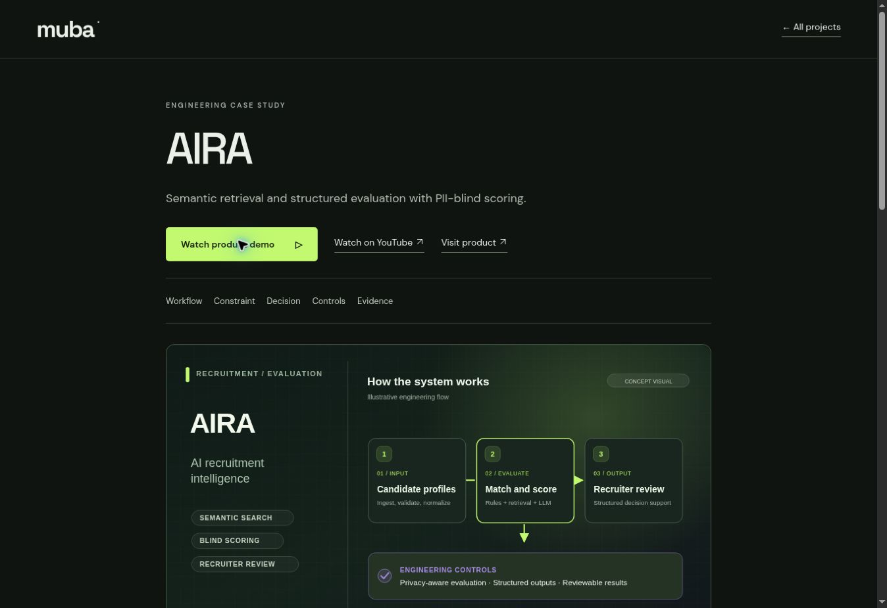
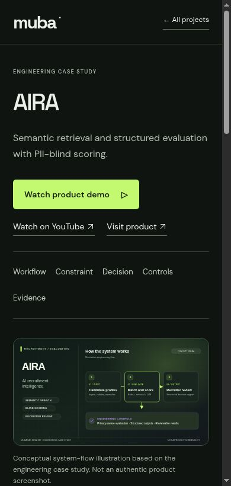

# Portfolio review, November 17, 2026

Reviewed the live homepage, all four project case studies, all five architecture illustrations, project filtering, architecture stage controls, demo dialogs, curated Q&A, blog search and empty state, and the three scripted security-lab scenarios. Changes preserve the existing project descriptions, demonstrations, resume, portrait, and conceptual-image disclosures.

## Comparison

These are reference examples, not a claim of an objective ranking of portfolios. Their current public pages were reviewed through web retrieval.

| Reference | Useful strength | Application to this portfolio |
| --- | --- | --- |
| [Chip Huyen](https://huyenchip.com/) | Direct links from her introduction to concrete tools, work, and technical resources | Add clear routes from the introduction to an engineering case study, the interactive lab, and recruiter answers |
| [Eugene Yan](https://eugeneyan.com/) | Clearly separated writing, prototypes, topic paths, and evidence of engineering work | Make the existing evidence easier to reach without adding an ungrounded chatbot or more decoration |
| [Hamel Husain](https://hamel.dev/) | Focused technical positioning backed by applied writing and open-source references | Retain explicit contributions, engineering decisions, and honest limitations in the case studies |

The portfolio already has a stronger product-showcase treatment than these writing-led examples. Its dark green/lime identity and existing content did not need a wholesale redesign. The largest remaining content opportunity is richer, permission-cleared product evidence and measured outcomes with context, especially for Diogenes and Find Your Fit. No invented results or synthetic product screenshots were added.

## Findings and implemented changes

| Finding | Improvement |
| --- | --- |
| Project-card diagrams were forced into fixed-height `object-fit: cover` boxes; captions covered their lower content | Preserve the full diagram aspect ratio and move captions below images |
| SVG diagrams had no explicit font family and rendered in a serif fallback inconsistent with the site | Self-contained Arial/Helvetica/sans-serif typography in all five SVGs |
| Small diagram text is difficult to inspect on phones | Accessible enlargement dialog, horizontally scrollable full-size image, Escape dismissal, and focus restoration |
| Product demos and external evidence were buried below long case studies | Add evidence actions directly beneath project introductions, while retaining original evidence links |
| Case studies offered no section index or next-project route | Add section anchors and related-project navigation to all four pages |
| Mobile hero had a forced line break and excessive wrapping | Fluid heading size, natural mobile wrapping, and wrapping action rows |
| Navigation becomes crowded before the original 700px breakpoint | Menu at 900px and below, larger link targets, outside-click dismissal and breakpoint state reset |
| Some external arrow glyphs rendered as missing-font squares | Inline SVG indicators independent of symbol fonts |
| Filtering gave no accessible result count and did not refresh scroll progress | Live result count and progress recalculation after filters and content resizing |
| Recruiter answer was initially empty without JavaScript | Static initial answer and no-script links to relevant sections |
| Lab result updates lacked an announcement region | Polite status announcements; deterministic simulation logic unchanged |
| Internal pages lacked skip links | Skip links on project pages and lab |

## Validation

- `python3 scripts/check_site.py`: passed for all 10 HTML pages. Checks local link targets and fragments, duplicate IDs, single h1, image alt text, SVG XML, and JavaScript syntax.
- `git diff --check`: passed.
- Browser responsive layout checks: homepage, four case studies, blog index and lab at 320, 390, 768 and 1024px iframe widths. No document horizontal overflow. These are browser CSS viewport checks, not physical-device or touch emulation; the browser reserves 15px for its vertical scrollbar.
- Browser image checks on those seven pages: no completed image with zero natural width.
- Original paragraphs on all four case studies and all original SVG text labels preserved by source comparison.
- Project filters and result count, inline case-study disclosure, tablet/mobile navigation and close-on-selection verified.
- Existing architecture buttons on all four live project pages and recruiter security answer verified.
- Shared AIRA and Spidify video dialogs use the original video IDs; closing removes the iframe and restores trigger focus. AIRA's live embed loaded the video title and controls. Playback continuity depends on YouTube and was not verified end to end.
- Diagram dialog opens, dismisses with Escape, and restores focus.
- Live blog search finds the webhook article and displays an empty state for unmatched queries.
- All three live lab scenarios produce their expected simulated allow/deny decisions and enable export. Report-download contents were not separately inspected; export logic was not changed.
- Existing reduced-motion rules retained; print styles now prevent reveal-animation classes hiding printed content. OS-level reduced-motion behavior was not emulated.
- No Lighthouse score or complete WCAG conformance claim. External product authentication, private workflows, and every external destination were outside this review.

## Screenshots

Desktop case study:

Mobile case study, 390px browser frame:

